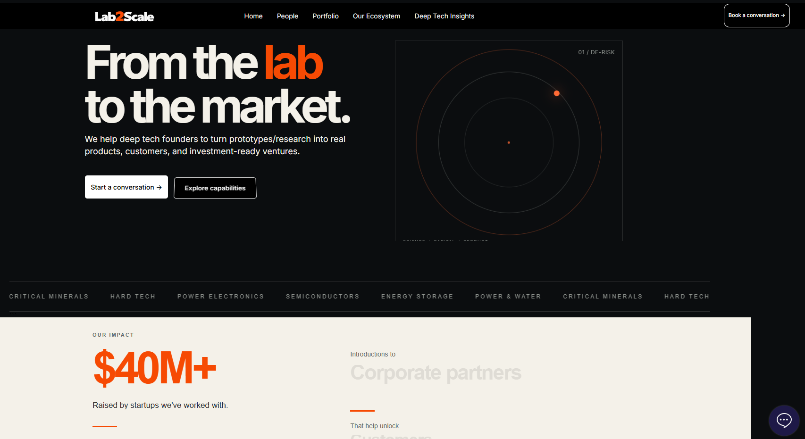
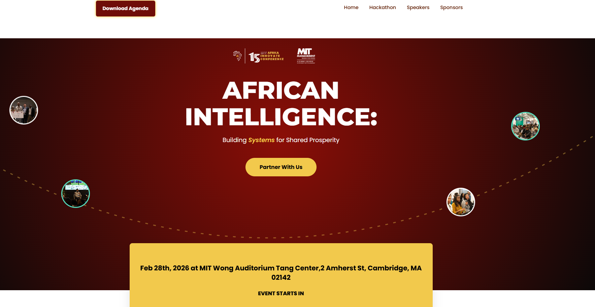

# Patrick Keli Atitsogbui

**Computer Engineer | IT Infrastructure | Systems Integration | Cybersecurity | Web Development | Emerging Technology**

I am an IT professional at Ghana's National Information Technology Agency (NITA), with experience spanning IT infrastructure operations, data centre management, IT service management, technical standards, enterprise architecture, and digital transformation.

Alongside my work in technology governance and standards, I design and develop websites and digital solutions for clients. I am also interested in application development, systems integration, automation, and emerging technologies.

## Technical Interests

- IT infrastructure and platform operations
- Data centre operations and infrastructure monitoring
- Enterprise architecture and systems interoperability
- IT service management and cybersecurity
- Technical standards, compliance, and governance
- Website design and development
- Application development, testing, and troubleshooting
- AI, automation, and connected systems

## Data Centre Operations and Infrastructure Management

**Domain:** IT Infrastructure | Data Centre Operations | Infrastructure Reliability

**Role:** Data Centre Operations Management

Managed data-centre operations involving server and storage infrastructure, facility support systems, incident management, preventive maintenance, and physical security.

### Key Responsibilities

- Oversaw server and storage infrastructure as part of data-centre operations.
- Monitored and managed operational aspects of power, UPS, and cooling systems supporting the data-centre environment.
- Handled infrastructure incidents and troubleshooting to support service continuity.
- Coordinated preventive maintenance activities to support infrastructure reliability.
- Coordinated with vendors and service providers on infrastructure support and maintenance.
- Managed data-centre physical security and supported controlled access to the facility.

## Environmental Monitoring and Access Control

**Domain:** IT Infrastructure | Data Centre Operations | Environmental Monitoring | Physical Security

**Role:** System Management and Operations

Managed and operated existing environmental monitoring and electronic access-control systems supporting IT infrastructure facilities.

### Key Responsibilities

- Monitored environmental conditions, including temperature and humidity, to support oversight of the infrastructure environment.
- Monitored water-leakage and smoke/fire detection indicators to help identify potential environmental hazards.
- Monitored power and UPS status as part of infrastructure operational oversight.
- Operated electronic access-control systems to support authorised entry and physical security.
- Supported routine monitoring of environmental and facility conditions relevant to infrastructure reliability and operational risk management.

## Featured Client Projects

### 1. MIT Africa Business Challenge
**Role:** Website Design and Development

Designed and developed the website for the MIT Africa Business Challenge.

[Visit Website](https://themitafricachallenge.com/)

### 2. Lab-2-Scale
**Role:** Website Design and Development

Designed and developed the website for Lab-2-Scale.

[Visit Website](https://www.lab-2-scale.com/)

*Homepage design for Lab-2-Scale.*

### 3. CESILC Legacy
**Role:** Website Design and Development

Built the website for CESILC Legacy.

[Visit Website](https://cesilclegacy.com/)

### 4. MIT Africa
**Role:** Website Design and Updates

Contributed to the website's design and implemented updates to the MIT Africa website.

[Visit Website](https://mit-africa.com/)

*Website design and updates for MIT Africa.*

## Professional Contributions

- Contributed to updating Ghana's Government of Ghana Enterprise Architecture (GGEA) and eGovernment Interoperability Framework (eGIF) version 2.0.
- Developed technical standards and guidance documents for Ministries, Departments, Agencies, and Metropolitan, Municipal and District Assemblies.
- Contributed to capacity building and knowledge sharing for public-sector ICT personnel, including training for over 300 personnel.

## Other Digital Initiatives

### Akordu Digital

Technology and digital initiatives focused on learning, innovation, and practical digital solutions.

[Visit Website](https://akordudigital.com/)

I am building this GitHub profile to showcase selected projects, technical experiments, and practical lessons from my work in technology and digital development.

## Certifications

- PRINCE2
- ISO/IEC 20000
- ITIL 4 Foundation
- ICT Accessibility: The Key to Inclusive Communication — ITU

## Connect With Me

- **Website:** [Akordu Digital](https://akordudigital.com/)
- **GitHub:** [GeneralKELI](https://github.com/GeneralKELI)
- **LinkedIn:** Add your LinkedIn profile URL here.

I welcome opportunities to contribute to IT infrastructure and platform operations, systems integration, web development, technology governance, and digital innovation.
